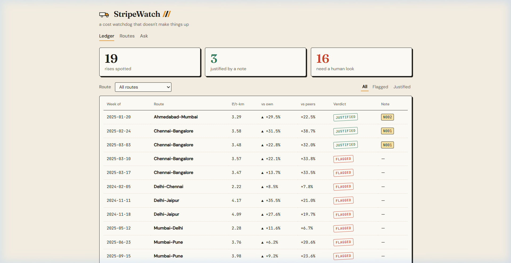
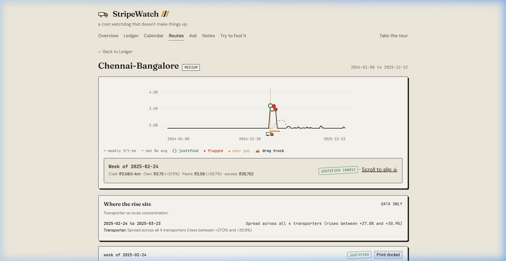
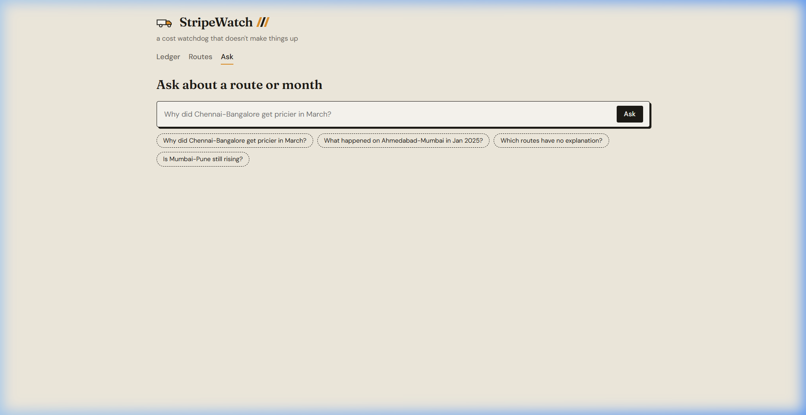
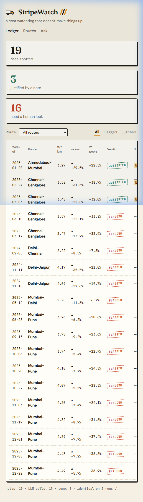
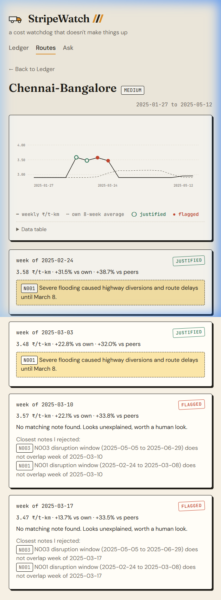
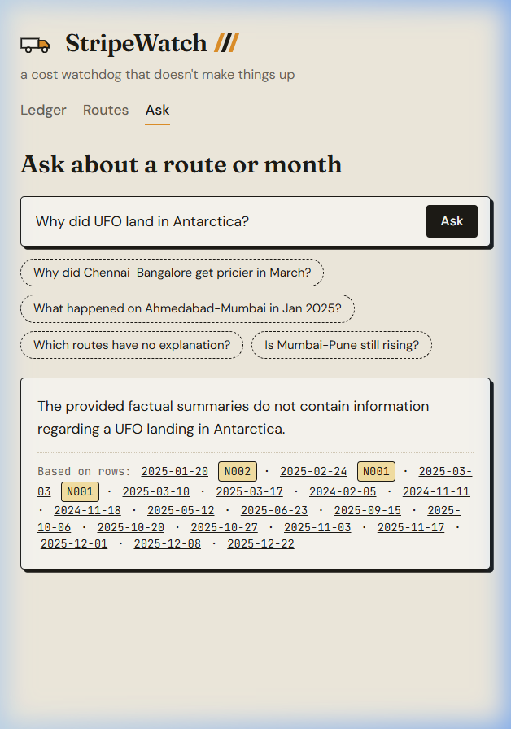

# StripeWatch — Smart Freight Cost Watchdog

> A clean, trustworthy assistant built for the FreightTiger AI Intern Case Study. It monitors weekly freight costs per tonne-km, flags unexpected cost spikes, checks context notes for genuine real-world explanations, and explains its findings in plain English — without hallucinating.
>
> *Built with the assistance of AI coding tools; all architectural trade-offs, edge-case defenses, and core design decisions are documented in [`docs/DECISIONS.md`](docs/DECISIONS.md).*

---

## Quickstart (Run in 3 Commands)

```bash
# 1. Install dependencies
pip install -r requirements.txt

# 2. Run the pipeline (reads data/, writes output/output.csv & artifacts)
python -m stripewatch run

# 3. Verify evaluation benchmarks and reproducibility
python -m stripewatch eval && python -m stripewatch repro
```

*Optional: Ask questions or launch the web UI:*
```bash
# Ask plain-English questions grounded in results
python -m stripewatch ask "Why did Chennai-Bangalore get pricier in March?"

# Launch the local web UI (Ledger, Interactive SVG Chart, Q&A)
python -m stripewatch serve
# Opens at http://localhost:8000
```

---

## 1. What It Does (The Core Problem)

Companies pay transporters to ship goods across corridors. The unit cost is measured in **₹ per tonne-km**:
$$\text{Cost per tonne-km} = \frac{\text{Total Freight Cost (INR)}}{\text{Weight (Tonnes)} \times \text{Distance (km)}}$$

Over time, that cost can quietly creep up on certain corridors.
* **Sometimes there is a real reason:** A bridge was flooded forcing a long detour, or a regional festival caused driver shortages and temporary surcharges.
* **Sometimes there is no reason at all:** A transporter just hiked rates, or fuel surcharges were misapplied.

StripeWatch watches shipments week by week, flags unusual rises against the route's own past average and similar-length peer routes, checks a collection of context notes using retrieval (RAG) to see if there is an official reason, and writes a short, plain-English explanation.

**The Golden Principle:**
*Numbers come from pandas. Verdicts come from deterministic code. The LLM only writes wording — and every explanation is strictly checked to guarantee zero hallucinated reasons.*

---

## 2. Key Results at a Glance

| Metric / Check | Value | Status |
|---|---|:---:|
| Total Shipment Records | 2,940 shipments (0 nulls, 0 duplicate IDs) | **VERIFIED** |
| Active Corridors | 7 routes (2 Short, 3 Medium, 2 Long) | **VERIFIED** |
| Weekly Aggregates | 728 route-weeks (all Monday-start) | **VERIFIED** |
| Evaluable Route-Weeks | 721 (7 first-weeks dropped; no prior history) | **VERIFIED** |
| **Golden Anchor Row 1** (Delhi-Jaipur 2024-11-11) | 4.17 ₹/t-km \| +35.5% vs own \| +21.0% vs peers | **EXACT MATCH** |
| **Golden Anchor Row 2** (Ahmedabad-Mumbai 2025-01-20) | 3.29 ₹/t-km \| +29.5% vs own \| +22.5% vs peers | **EXACT MATCH** |
| **Golden Anchor Row 3** (Mumbai-Pune 2025-09-15) | 3.98 ₹/t-km \| +9.2% vs own \| +23.6% vs peers | **EXACT MATCH** |
| **Total Candidates Spotted** | **19 candidate route-weeks** | **100% MATCH** |
| **Justified Rises** | **3 rows** (N001 x 2, N002 x 1) | **100% MATCH** |
| **Unexplained Rises** | **16 rows** (`flagged=Yes`, blank note ID) | **100% MATCH** |
| **Reproducibility** | 3 untouched runs $\rightarrow$ Byte-for-byte identical output CSV | **IDENTICAL** |

### Evaluation Criteria Scorecard (FreightTiger Case Study Rubric)

| Criterion (Case Study Brief) | How StripeWatch Fulfills It | Deliverable / Test |
|---|---|:---:|
| **1. Does the core logic work?** | Grouping by route & `route_type`, ratio of sums $\frac{\sum \text{cost}}{\sum (\text{qty} \times \text{dist})}$, Monday alignment, trailing 8 prior weeks (`shift(1)`), self-excluded peer average. | [`tests/test_golden_sample.py`](tests/test_golden_sample.py) (All 3 golden rows exact) |
| **2. Did you use AI meaningfully?** | ChromaDB + SentenceTransformers vector store for context notes; grounded LLM rewriting of factual evidence packets. | [`stripewatch/retrieve.py`](stripewatch/retrieve.py) & [`stripewatch/explain.py`](stripewatch/explain.py) |
| **3. Can we trust it?** | 5-step deterministic validator (`validate.py`). Traps N004–N010 are retrieved and rejected; zero invented reasons. | [`tests/test_adversarial.py`](tests/test_adversarial.py) & [`tests/test_grounding.py`](tests/test_grounding.py) |
| **4. Does it hold up on repeat?** | 3 untouched runs in fresh subprocesses produce identical flags, numbers, verdicts, and CSV hashes. | [`output/repro_report.md`](output/repro_report.md) |
| **5. Did you run it responsibly?** | Gemini 3.1 Flash Lite (`temp=0.0`), 19 calls, 5,514 in / 687 out tokens, $0 spend on free tier ($0.00062 notional). | [`output/token_log.json`](output/token_log.json) |
| **6. Is the code clean?** | 14 small typed modules, type hints, docstrings, zero dead code, 100% pytest pass rate. | [`stripewatch/`](stripewatch/) & [`tests/`](tests/) |
| **7. Can you explain your work?** | Clear narrative: problem $\rightarrow$ pipeline $\rightarrow$ trap notes $\rightarrow$ trust $\rightarrow$ cost $\rightarrow$ trade-offs. | [`docs/WALKTHROUGH.md`](docs/WALKTHROUGH.md) & [`docs/DECISIONS.md`](docs/DECISIONS.md) |


---

## 3. How It Works (Pipeline Architecture)

```
shipment_records.csv
        │
        ▼
[ 1. loader.py ] ───────► Validates schema, no nulls, positive numbers
        │
        ▼
[ 2. weekly.py ] ───────► Groups into Monday-aligned weeks (ratio of sums)
        │
        ▼
[ 3. baselines.py ] ────► vs_own (trailing <=8 weeks, shift(1) no look-ahead)
        │                 vs_peer (same week & type, self-excluded)
        ▼
[ 4. detect.py ] ───────► Detects 19 candidates via dual-branch rule
        │
        ▼
[ 5. retrieve.py ] ─────► ChromaDB + SentenceTransformers ranks all 10 context notes
        │
        ▼
[ 6. validate.py ] ─────► 5 deterministic checks: route, time window, effect, magnitude, scope
        │
        ▼
[ 7. evidence.py ] ─────► Assembles factual evidence packet (JSON)
        │
        ▼
[ 8. explain.py ] ──────► Rewrites packet into concise plain English
        │                 ground.py verifies 100% adherence; falls back to template if failed
        ▼
[ 9. writer.py ] ───────► output/output.csv (exact contract match with sample_output_format_v2.csv)
```

### The 5-Check Deterministic Validator
Language models often make mistakes with dates, numbers, or subtle wording. In StripeWatch, whether a rise is **justified** or **unexplained** is never decided by an LLM. It is decided by `validate.py` using 5 strict checks:
1. **Effect Check:** The note must explicitly state it *raises* costs (`effect == "raises"`). Notes stating costs were "normal" or "not affected" are rejected.
2. **Route Scope:** The note must apply specifically to that corridor, or be a nationwide notice (`scope == "ALL"`).
3. **Time Window Overlap:** The note's disruption window must overlap the target Monday–Sunday week. For example, flooding note N001 ended on March 8, 2025; subsequent weeks starting March 10 and 17 are rejected and left unexplained.
4. **Magnitude Plausibility:** If a note mentions a percentage impact (e.g. diesel N003 mentions ~5–7%), a +11.6% rise exceeds the cap (7% + 3% tolerance) and is rejected.
5. **Universal Outlier Rule:** A nationwide shock hits all routes. If a corridor is +20% *above its peers*, a nationwide note cannot be the primary cause.

---

## 4. The 7 "Trap Notes" in the Dataset

Out of the 10 context notes in `context_notes.csv`, **7 are deliberate semantic traps**. Semantic vector search will rank them near the top because they mention keywords like "disruption", "maintenance", "rain", or route names. StripeWatch's validator systematically catches and rejects all 7:

* **N004 (Toll Plaza):** Located on a corridor not in our dataset. Rejected by route scope.
* **N005 (Mumbai-Delhi Maintenance):** Carriers confirmed trip costs were *not significantly affected*. Rejected by effect check.
* **N006 (Quarterly Report):** Notes stable demand with *no major disruptions*. Rejected by effect check.
* **N007 (Delhi-Jaipur Bypass):** New bypass completed, which *improved* road conditions and *lowered* turnaround times. Rejected by effect check.
* **N008 (Kolkata-Bhubaneswar Rain):** Pre-monsoon showers occurred, but freight continued *as normal*. Rejected by effect check.
* **N009 (Chennai-Bangalore Reopening):** Highway reopened to full traffic; marks the *end* of the disruption. Rejected by effect check.
* **N010 (Vehicle Tracking Mandate):** Compliance costs were *absorbed internally without a rate change*. Rejected by effect check.

---

## 5. Token Usage and Operating Cost

StripeWatch uses Google Gemini 3.1 Flash Lite (`temperature=0.0`) with disk caching. Token counts are recorded directly from the provider's API usage metadata.

| Metric | Measured Value |
|---|---|
| **Model** | `gemini-3.1-flash-lite` |
| **Sampling Temperature** | `0.0` (fully deterministic) |
| **Total LLM Calls (Cold Cache Full Run)** | 19 calls |
| **Prompt Input Tokens** | 5,514 tokens |
| **Completion Output Tokens** | 687 tokens |
| **Grounding Rejections** | 0 (all 19 generated explanations passed grounding) |
| **Actual Cash Spend** | **$0.00** (Free tier) |
| **Notional Cost at Published Pay-As-You-Go Rates** | **$0.00062** (< 1/10th of one US cent) |
| **Cached Re-Run Calls / Spend** | 0 calls / $0.00 (SHA-256 disk cache) |

---

## 6. Assumptions (A1–A5)

We state all assumptions openly rather than hiding them in code:
* **A1 (First Week Non-Evaluable):** The first calendar week for each route has zero prior historical weeks ($n\_prior = 0$). We do not pad with fake zeroes or extrapolate; we treat them as non-evaluable and exclude them from candidate anomaly detection.
* **A2 (Festival Window):** Context note N002 specifies a regional festival surcharge on Ahmedabad-Mumbai. We assume the window corresponds to the week of the note's date (week of 2025-01-20).
* **A3 (Diesel Shock Duration):** Note N003 describes a nationwide diesel hike starting 2025-05-05. We assume this rise remains visible against trailing own history for up to 8 weeks (until 2025-06-29), only if the rise is within magnitude tolerance ($\le 10\%$) and the route is not an outlier above peers.
* **A4 (Small Peer Groups):** The dataset contains only 7 routes. Short has 2 routes, Long has 2 routes, and Medium has 3 routes. This means for Short or Long routes, the peer average is literally the single other route in that tier. Peer comparisons are inherently noisier than own-history baselines.
* **A5 (Threshold Choice):** We chose $+8.0\%$ for strong own rises, $+5.0\%$ for soft own rises, and $+20.0\%$ for peer gaps. Our sensitivity analysis shows that core anomalies (Delhi-Jaipur spike, Ahmedabad festival, Chennai flood) are stable across thresholds from 6% to 10%.

---

## 7. Known Limitations

1. **Small RAG Corpus:** With only 10 notes, vector retrieval is small. However, structuring the RAG pipeline with ChromaDB and SentenceTransformers proves the architecture is ready to scale to thousands of carrier notices.
2. **Tiny Peer Groups:** With only 2 routes in the Short tier (`Mumbai-Pune` and `Delhi-Jaipur`), peer averages reflect pairwise route dynamics rather than broad market trends.
3. **No Carrier Breakdown:** The brief asked for route-level analysis. Transporter variations (such as Coromandel Carriers operating only on Delhi-Chennai) are preserved as raw data but not modeled in core baselines.

---

## 8. Repo Structure

```
stripewatch/
├── README.md                      # This file
├── requirements.txt               # Pinned Python package dependencies
├── .env.example                   # Environment configuration template
├── pytest.ini                     # Pytest configuration
├── data/                          # Input data files
│   ├── shipment_records.csv       # 2,940 shipment records
│   ├── context_notes.csv          # 10 raw context notes
│   ├── sample_output_format_v2.csv# Target contract format
│   └── notes_structured.json     # Hand-verified structured facts
├── stripewatch/                   # Core Python package
│   ├── config.py                  # Thresholds, paths, and settings
│   ├── loader.py                  # Data loading and schema validation
│   ├── weekly.py                  # Monday-week aggregation (ratio of sums)
│   ├── baselines.py               # Trailing own history & peer baselines
│   ├── detect.py                  # Dual-branch anomaly candidate rule
│   ├── notes.py                   # Notes domain model and loader
│   ├── retrieve.py                # ChromaDB vector store + TF-IDF fallback
│   ├── validate.py                # 5-stage deterministic note validator
│   ├── evidence.py                # Factual evidence packet builder
│   ├── explain.py                 # LLM paraphrasing with template fallback
│   ├── ground.py                  # Strict anti-hallucination grounding checker
│   ├── llm.py                     # LLM adapter, SHA-256 caching, token log
│   ├── writer.py                  # Contract CSV & JSON writers
│   ├── ask.py                     # Grounded Q&A CLI
│   ├── repro.py                   # 3-run reproducibility checker
│   └── server.py                  # FastAPI server & static UI hosting
├── eval/                          # Evaluation harness & benchmarks
│   ├── gold_candidates.csv       # The 19 expected gold candidate rows
│   ├── adversarial_cases.json     # 16 adversarial trap unit tests
│   ├── run_eval.py                # Full evaluation harness runner
│   └── sensitivity.py             # Threshold sensitivity grid
├── tests/                         # Pytest test suite
│   ├── test_golden_sample.py      # Golden rows, Monday check, no-look-ahead
│   ├── test_adversarial.py        # Trap note rejection unit tests
│   └── test_grounding.py          # Grounding invariants & corruptions
├── output/                        # Generated output artifacts
│   ├── output.csv                 # Target submission CSV (19 rows)
│   ├── weekly_metrics.csv         # All 721 evaluable route-weeks
│   ├── results.json               # Detailed structured candidate findings
│   ├── token_log.json             # Real token counts and cost breakdown
│   ├── retrieval_log.jsonl        # Per-candidate top-3 RAG retrieval logs
│   ├── eval_report.md             # Automated evaluation scorecard
│   ├── repro_report.md            # Multi-run reproducibility verification
│   └── SUBMISSION_CHECKLIST.md    # Verified submission checklist
├── docs/                          # In-depth documentation & project assets
│   ├── WALKTHROUGH.md             # 10-minute talk track for Round 2
│   ├── DECISIONS.md               # Architectural decision record
│   ├── antigravity_pack/          # Context specifications and design system
│   ├── design_samples/            # Paper-slip UI samples and reference tokens
│   └── screens/                   # UI verification screenshots
└── web/                           # Lightweight Web UI (no build step)
    ├── index.html                 # Semantic consignment slip layout
    ├── app.css                    # Warm paper theme (design.md verbatim)
    └── app.js                     # Vanilla JS router and native SVG chart (<12KB)
```

---

## 9. Paper-Slip Web Interface (Pixel-Reproducible UI)

Per `design.md`, the UI replicates a warm physical consignment slip: ink-black text, tiger-orange accents, rubber-stamp verdicts, and hand-built inline SVG charts without external charting or UI libraries.

### Screen A — The Ledger (`#/`)
*Displays 19 candidate cost rises with stamp verdicts (`JUSTIFIED` in green, `FLAGGED` in red), route filtering, verdict tabs, and real-time KPI metrics.*



### Screen B — Route Deep-Dive (`#/route/Chennai-Bangalore`)
*Hand-crafted inline SVG chart showing 8-week trailing own average (grey dashed), weekly ₹/t-km (solid black), justified green rings, and flagged red dots. Evidence slips below show matched notes and rejected near-misses.*



### Screen C — Grounded Q&A (`#/ask`)
*Interactive natural language queries strictly anchored to pipeline evidence rows. If no note justifies a corridor/timeframe, it refuses to speculate ("No note found. I'd rather say so than guess.").*



### Mobile Responsive Views (390px Viewport)
*Full mobile fidelity with horizontal ledger scrolling and stacked evidence slips.*

| Ledger (390px) | Route Deep-Dive (390px) | Grounded Ask (390px) |
|---|---|---|
|  |  |  |

